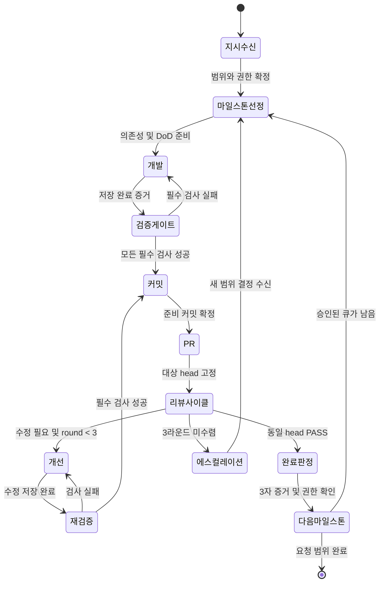

# 마일스톤 루프 운영 매뉴얼

**PROPOSAL — 하네스가 실행할 계약.** M1은 이 운영 문서와 [설치 가능한 스킬](../skills/milestone-loop/SKILL.md)을 제공한다. 실제 CI/PR/Slack 자동화 실행은 프로젝트의 권한·도구·환경이 갖춰져야 한다. [로드맵](ROADMAP.md)의 현재 신뢰 단계보다 넓게 실행하지 않는다.

## 상태와 소유권

코디네이터가 지시 범위·DAG·현재 상태·리뷰 라운드·판정을 관리한다. worker가 구현과 자체 검증을 수행하고 reviewer는 지정 revision을 읽기 전용으로 검토한다. 같은 역할의 자기 보고를 독립 리뷰로 기록하지 않는다.



수정 커밋을 만들어도 같은 마일스톤의 round를 초기화하지 않는다. 검증 실패·환경 불가·권한 불명은 성공 전이가 아니며 아래의 제한된 복구 후 에스컬레이션한다.

| 상태 | 진입 조건 | 행동과 종료 조건 |
|---|---|---|
| 지시수신 | 사용자의 구현 요청 | issue ID·범위·제외·기준 브랜치·외부 작업 권한·완료 문구를 기록. 모호한 필수 조건만 확인 |
| 마일스톤선정 | 승인된 요청 | 선행 의존성이 끝난 가장 작은 단위 선택. DoD 명령, expected exit, 재현 기능, reviewer, 예산 확정 |
| 개발 | 실제 dispatch 수락·작업 시작 | 지정 순서로 구현. 코드 구조는 Mnemosyne에서 찾고 소스 확인. 파일 저장 후 자체 검증과 보고 작성 |
| 검증게이트 | worker 완료 증거 | 코디네이터가 파일·diff·mtime·내용 hash를 별도 확인. 필수 명령 전부 exit 0이어야 커밋으로 이동 |
| 커밋 | 동일 내용에 유효한 gate 결과 | 허용 파일만 stage. `feat(<milestone>): <한국어 요약>` 또는 `docs(...)`. branch/commit/base SHA 기록 |
| PR | 준비 커밋 존재·push/PR 권한 확보 | PR 생성 또는 같은 PR 갱신. head SHA, CI, 변경 범위, 검사 결과를 고정 |
| 리뷰사이클 | 저장 안정·CI·review head 확정 | read-only reviewer가 findings와 판정 제출. 첫 판정 round=1, 수정 재리뷰마다 +1 |
| 개선 | REQUEST CHANGES 또는 CONDITIONAL PASS, round<3 | BLOCKER→MAJOR→MINOR 순으로 정확한 잔여 항목만 수정. 다른 변경을 끼우지 않음 |
| 재검증 | 수정 완료·새 디스크 증거 | 영향 검사와 모든 필수 DoD 재실행. 성공 후 수정 커밋·동일 PR 갱신·좁힌 재리뷰 |
| 완료판정 | 동일 head의 최종 PASS | 3자 증거, CI, 문서/인계, 권한 확인. 승인된 단계 3에서만 병합. 병합이 DoD면 병합 SHA도 확인 |
| 다음마일스톤 | 완료 기록 확정 | handoff·보고·큐 갱신. 승인 범위의 다음 의존성 노드로 이동하거나 종료 |
| 에스컬레이션 | 상한 도달 또는 해결 불가 | 원인·시도·마지막 유효 revision·선택지·필요 결정을 보고하고 의존 작업만 보류 |

## 실행 시작 — Orca

아래는 Orca 1.4.212 CLI help 기준 예제다. 현재 설치에서 `orca skills get orca-cli`와 해당 `--help`를 읽고 실제 반환 ID를 넣는다. 대괄호 없는 `<...>`는 치환할 자리다. shell alias가 아닌 실제 하네스 실행 파일을 사용한다.

```bash
orca terminal create --worktree id:<repo-id>::<absolute-path> --title M1-worker --command 'ai-memory run --new M1-worker codex' --json
orca terminal wait --terminal <worker-handle> --for tui-idle --timeout-ms 60000 --json
orca orchestration task-create --spec '<자기완결 브리프: 범위, 절대경로, 순서, DoD, 완료보고 경로>' --task-title 'M1 구현' --from <coordinator-handle> --json
orca orchestration dispatch --task <returned-task-id> --to <worker-handle> --from <coordinator-handle> --inject --json
orca orchestration check --terminal <coordinator-handle> --wait --types worker_done,status,escalation --timeout-ms 60000 --json
```

`tui-idle`의 `satisfied:true` 이후에만 dispatch한다. task ID는 생성 결과를 사용하며 spec 안의 임의 `id`를 신뢰하지 않는다. dispatch preamble의 task/dispatch/run/송신 식별자를 기록한다. run이 바인딩된 환경에서는 같은 run에 연결한다. supervised 작업은 task/dispatch를 쓰고 단발 상태 리뷰는 status/handoff를 쓴다.

`accepted:true`는 입력 수락이며 작업 시작 증거는 아니다. 터미널 상태와 새 파일/검사 진행을 확인한다. 모호한 전송 결과는 request ID로 조회·조정하고 무작정 재전송하지 않는다. handle이 stale이면 terminal list에서 같은 pane/leafId를 찾아 새 handle 하나로만 이어간다. 실행 중인 worker를 확인 없이 복제하지 않는다.

## worker_done 계약

worker가 완료 보고를 저장한 다음 **실제 dispatch된 pane**에서 preamble과 일치하는 식별자로 보낸다.

```bash
orca orchestration send --type worker_done --outcome succeeded --task-id <task-id> --dispatch-id <dispatch-id> --from <preamble-worker-handle> --subject 'M1 검증 완료' --report-path <absolute-report-path> --files-modified <comma-separated-paths> --json
```

실패 시 `--outcome failed`와 실패 원인·다음 조치를 담는다. 활성 Dispatch에서는 수신자를 생략하면 소유 Run mailbox로 간다. group으로 worker_done을 보내지 않는다. 일반 `status`를 받았으면 완료 후보로만 보고 task/dispatch와 파일 증거를 확인한다. 코디네이터가 worker인 척 완료 신호를 만들지 않는다.

필수 보고 필드:

```text
issue / milestone / task_id / dispatch_id / round
작업 경로 / branch / base SHA / head SHA
변경 요약 / 파일 목록 / 저장 완료 시각 / 보고 시각
검증별 명령 / cwd / exit code / 결과 / 로그 경로
review verdict 및 reviewed SHA (없으면 미실행)
git diff --stat (빈 결과도 그대로)
git diff <base>...HEAD --stat (커밋된 전체 변경)
핵심 파일 stat -f '%Sm %N' 결과 (Linux: stat -c '%y %n')
잔여 위험 / 미검증 영역 / 차단 항목 / 다음 작업
ai-memory session 종료 확인 / handoff 식별자 또는 미사용 사유
```

명령이 없는 “통과”나 실제 출력 대신 작성한 예상 출력은 증거가 아니다.

## 디스크 게이트와 3자 검증

worker 보고 → 코디네이터의 디스크 확인 → reviewer의 독립 스냅샷 순서다. `git diff --check`, 파일 존재·내용, `git diff --stat`, 커밋된 diff, mtime/hash를 확인한다. 5초 간격 두 번의 관측이 같아야 리뷰를 dispatch한다. mtime은 수정 요청 이후 변경됐는지 확인하되 완료 보고 이후 계속 증가하면 저장 경쟁으로 처리한다. 시간만으로 동일 내용을 단정하지 않는다.

reviewer는 관측 시각과 head SHA/dirty diff hash를 판정에 포함한다. 저장 전 파일을 읽은 리뷰가 발견되면 당시 판정을 보존하고 새 스냅샷으로 재리뷰한다. PASS 뒤 내용이 바뀌면 기존 PASS는 새 내용에 적용하지 않는다.

## 리뷰 수렴과 상한

리뷰 출력: `severity / file:line / 영향 / 수정 제안`, verdict `PASS | CONDITIONAL PASS | REQUEST CHANGES`, 잔여 위험, 다음 재리뷰 범위. reviewer는 수정·커밋하지 않는다. CONDITIONAL PASS의 소수 항목도 집중 수정 후 최종 PASS를 받아야 완료한다. 합의된 후속 이관 항목은 별도 issue·판정자·사유가 있어야 한다.

첫 리뷰 포함 **최대 3라운드**다. 세 번째도 미수렴이면 더 작은 범위, 요구사항 결정 또는 설계 변경으로 에스컬레이션한다. 코디네이터가 round를 0으로 리셋하여 같은 작업을 계속하지 않는다. 기계 검사 실패의 로컬 수정은 3회 또는 사전 합의 시간 예산까지 수행하고 같은 원인 반복 시 로그를 첨부한다. 생산적인 작업을 단순 시간 경과만으로 강제 종료하지 않는다.

## 메시지 대기와 복구

현재 `check`는 FIFO Delivery 전체를 반환하며 `--types`는 wait를 깨우는 조건이다. 모든 메시지를 처리하고 delivery ID로 ACK한다. timeout이면 inbox/terminal/disk를 확인한다. 이전 버전이나 stderr 병합 출력의 `_keepalive`·`_heartbeat` 행을 실제 메시지로 파싱하지 않는다.

자기 발신·이전 task·이전 dispatch·이전 round를 완료로 오인하지 않는다. 새 메시지는 subject가 아니라 ID로 비교한다. 60초 이하의 rolling wait를 쓰고 주기적으로 진행 증거를 확인한다. 연속 5회 확인에서 파일/로그에 진전이 없으면 원인을 조사하고 필요한 결정을 에스컬레이션한다.

프로세스 중단 후에는 마지막 유효 커밋·dirty diff·미완료 task·리뷰 round를 복원한다. ai-memory 인계와 현재 소스를 대조하고 이미 완료된 명령·커밋·PR·메시지를 재실행하지 않는다. 작업 상태의 authority는 Orca와 리포 증거이며 기억은 복구의 단서다. Orca로 여러 하네스를 섞어 쓸 때의 전환·병행·크래시 복원 시나리오는 [KN-2026-09-26 멀티 하네스 인계](knowledge/KN-2026-09-26-multi-harness-handoff.md)를 따른다.

## Slack 진행 보고 — PROPOSAL

사용자가 보고를 승인하고 채널/연결 수단을 지정한 실행에서만 발송한다. 단계 완료(개발, gate, PR, 리뷰, 마일스톤), 차단·복구, 최종 종료에 보고한다. 진행 중 기본 하트비트 간격은 **5분**, 무변경 반복 보고는 합친다. 현재 대화의 진행 안내 주기와 Slack 주기는 별개다.

payload는 milestone, phase, elapsed, 검사 요약, commit/PR, blocker, 다음 행동만 담는다. event key를 `run/task/phase/revision/round`로 만들고 발송 receipt를 보관한다. 하트비트에는 시간 구간을 추가한다. timeout의 모호한 성공은 영수증/대상 메시지를 조회한 뒤 재시도한다. 연결 실패는 미전송 큐와 오류를 기록하고 기계 게이트를 성공으로 바꾸지 않는다. 보고 전달이 필수 DoD이면 미전송 상태에서 마일스톤 완료하지 않는다.

채널 미설정 시 보고 초안을 로컬 증거에 남긴다. 승인 요청은 사용자의 입력 수단을 따른다(Spokenly 사용 환경은 `ask_user_dictation`). Slack 수집과 발송은 별개며 Onyx/Slack 제한 원문은 ai-memory나 일반 Mnemosyne graph로 복사하지 않는다.

### 에이전트 간 Slack 멘션 — 2026-09-28 실측

에이전트(봇 프로필)끼리는 **정식 Slack 멘션으로만 서로를 깨울 수 있다.** 게이트웨이 설정 `allow_bots: mentions`는 봇이 보낸 메시지를 **정식 멘션일 때만** 수신한다는 뜻이다.

- 마크다운 텍스트에 `@이름`을 쓰는 것은 멘션이 아니다. 봇이 보내는 메시지는 Slack 자동완성 없이 게시되므로 `@Hassan` 같은 텍스트는 `<@U0...>` 형식의 user ID가 없으면 수신자에게 도달하지 않는다(실측: degaza-v2 PR 리뷰 요청이 수신되지 않은 사례).
- 멘션 형식: 본문에 `<@U0XXXXXXXX>`처럼 user ID를 직접 포함한다. 봇도 워크스페이스 멤버로서 bot user ID(`U` 또는 `W` 접두)를 가지므로 멘션이 가능하다.
- **발송 명령**(코디네이터가 사용자 중개 없이 검수 요청을 보낼 때):

```bash
hermes send -t "slack:<chat_id>:<thread_ts>" "<@<상대_봇_ID>> 메시지 본문"
```

`hermes send`는 현재 프로필의 gateway 자격증명을 재사용하므로 토큰 파일 열람이 필요 없다. auth.json에서 토큰을 직접 추출해 curl로 보내는 방식은 not_authed 실패(실측)다. 토큰을 열람해도 안 되는 이유는 원칙이며, 아니되오까.

- **스레드 원문의 `<@U...>`가 상대라는 보장이 없다.** 내가 처음 받은 메시지에 태그된 ID는 나 자신일 수 있다(degaza-v2 실측: 자기 ID를 Hassan으로 오인 발송 → 상대 무수신 → 상대 세션 기록으로 정정). ID 경합 가능성이 있으면 위 표기 위주 실측 순서로 확인하고, 최종 증거는 **발송 후 상대 gateway.log의 `inbound message` 착륙 행**이다.

**user ID 찾는 법 (빠른 순):**

1. Slack UI: 대상 이름을 `@`로 입력해 자동완성으로 선택하면 정식 멘션이 된다. ID를 직접 확인하려면 프로필 → 더 보기 → "멤버 ID 복사"(Copy member ID).
2. 수신 측 게이트웨이 로그: `grep -oE "U[A-Z0-9]{9,11}" ~/.hermes/profiles/<profile>/logs/agent.log` — inbound 메시지의 발신자 ID가 기록된다. 자기 로그에만 있는 ID는 남이고, 원하는 에이전트가 보낸 메시지 1건이 있으면 그 ID를 재사용한다.
3. 발신 봇의 자기 식별: 대상 게이트웨이의 `gateway.log`에서 `Authenticated as @<handle>` 행으로 봇 이름을, 대화 원문의 `<@...>` 멘션으로 ID를 확인한다. 토큰·자격증명 파일은 열지 않는다.

**수신 확인:** 상대 프로필 `logs/agent.log`의 `inbound message` 행으로 전달 여부를 확인한다. `allow_bots`의 기본값은 봇 메시지 무시일 수 있으므로, 봇 간 라우팅이 실패하면 먼저 양쪽 `config.yaml`의 `slack.extra.allow_bots`를 확인한다. 멘션에도 무응답이면 상대 Socket Mode 재접속 로그(`Socket Mode unhealthy`)를 확인하고 게이트웨이 재시작은 사용자가 수행한다.

**멘션된 에이전트만 응답 — 나머지는 침묵(2026-09-28 사용자 규칙):** 그룹 채널에서 사용자가 멘션한 에이전트(앱)만 응답하고, 멘션되지 않은 에이전트는 반응하지 않는다. 이 규칙은 에이전트가 Slack으로 사용자·다른 에이전트와 대화할 때 항상 적용한다. 자신에게 향한 요청이 아니면 침묵을 기본값으로 삼는다(진행 중인 자기 작업의 소유자 보고는 예외). 코디네이터가 작업을 배정할 때도 정식 멘션으로만 타깃을 지정해 다른 에이전트가 끼어들지 않게 한다.

## 설치 프로젝트 참고 — 실측 절차 인덱스

다른 프로젝트에 칼데아 워크플로우를 설치해 운영할 때, 이 저장소의 knowledge 문서가 절차 정본이다. 운영 중 새 실측이 나오면 `docs/knowledge/KN-<날짜>-<주제>.md`로 추가하고 이 인덱스에 연결한다.

- [KN-2026-09-26 멀티 하네스 인계](knowledge/KN-2026-09-26-multi-harness-handoff.md) — 하네스 혼용 시 기억 공유·인계·크래시 복원.
- [KN-2026-09-28 봇 멘션 디스패치와 리커버리](knowledge/KN-2026-09-28-bot-mention-dispatch-and-recovery.md) — 봇→봇 정식 멘션 발송·수신 실측(hermes send), ID 오인 함정, 모니터 설계(from_handle 필터·timeout 래핑), 워커 사망·디스패치 오배정·리베이스 레이스 복구 절차. degaza-v2 마일스톤 3건 연속 merge 실측 기반.

## 기억과 다음 작업

시작/세션 재개는 ai-memory handoff를 먼저 확인하며 없으면 정확한 scope에서 목록 후 선택 수락한다. 구조 질의는 Mnemosyne로 보내고 소스 revision을 확인한다. 동일 질문을 이중 질의하지 않는다. 확정된 구조 지식만 출처를 유지해 graph에 반영하며 durable memory 수동 쓰기는 사용자의 요청 범위를 따른다.

Codex/agy는 [설치 지침](install.md)의 exact-session finalize 규칙을 완료 보고 전에 수행한다. graph 갱신은 provider 정책을 확인한 승인 소스만 대상으로 한다. 다음 마일스톤 브리프에는 이전 PASS revision, 미해결 항목, 재현 경로, 검증 명령을 포함한다. 반복 지적은 새 스킬 설명뿐 아니라 회귀 검사로 연결한다.
